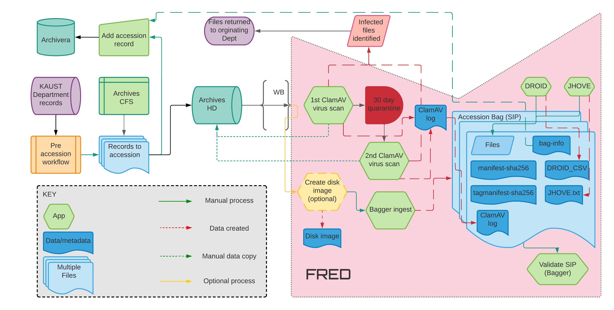

# ArchiveAutomation



*The diagram shows the earlier version, where metadata came from ArchivEra; since 0.7 it comes from the accession register.*

[](https://zenodo.org/badge/latestdoi/424499129)

Automate the digital preservation ingest workflow: from a folder of files to a
validated [BagIt](https://www.rfc-editor.org/rfc/rfc8493) bag that carries its
own preservation metadata, ready to upload to the preservation system
([Libnova LIBSAFE](https://www.libnova.com/)).

For each accession the workflow:

1. **Checks the accession's metadata** in the accession register against the
   shared vocabulary, and stops with every problem listed before anything is
   scanned or copied.
1. **Scans the files with ClamAV** (in Docker), then holds the accession in
   **quarantine** for a set number of days and scans again.
1. **Copies the files into a BagIt bag** with SHA-256 manifests.
1. **Runs [DROID](https://www.nationalarchives.gov.uk/information-management/manage-information/preserving-digital-records/droid/)**
   to identify file formats.
1. **Writes the metadata into the bag**: DC.FORMAT as
   [IANA media types](https://www.iana.org/assignments/media-types) and
   DC.FORMAT_EXTENT from DROID's results, plus every register field, in
   `bag-info.txt`, `bag-info.xml` and `libnova_metadata.json`.
1. **Runs [JHOVE](https://jhove.openpreservation.org/)** to validate formats.
1. **Updates the tag manifest**, so every file in the bag has a checksum.

Field names are Libnova IECodes (`title`, `DC.TYPE`, `DC.RIGHTS_ACCESS`, ...),
the same ones used for physical collections, so digital and physical records
share one schema. See [METADATA.md](METADATA.md) for the register, the
vocabulary and the output files.

## What's new in 0.7

- Metadata comes from an **accession register** (CSV) checked against a shared
  **vocabulary folder**, replacing the ArchivEra API and the `[BAG-INFO]` section.
- DC.FORMAT uses IANA media types and DC.FORMAT_EXTENT is computed from DROID.
- New output files: `bag-info.xml` in the Libnova export structure and
  `libnova_metadata.json`, the body for Libnova's metadata API.
- The tag manifest now covers `bag-info.xml`, the metadata files and the
  DROID/JHOVE reports.
- ClamAV runs in Docker; the scan shows its progress and a failed scan (e.g.
  Docker not running) stops the workflow instead of being misread.
- Runs on Python 3.13 (removed the `cgitb` import).
- The `archiveautomation` command works (the `aalib` module is now packaged).
- Tests: `python -m pytest tests`.

## Requirements

Tested on Windows 11.

| Component | Notes |
| --- | --- |
| Git | |
| Python 3.12 or newer | Tested with 3.13 |
| Docker Desktop | Runs ClamAV (`clamav/clamav` image). Must be running during a scan. |
| DROID 6.8 or newer | The Windows download with embedded Java is simplest. Install to a path **without spaces**. |
| Java 21 | For JHOVE |
| JHOVE 1.34 or newer | Install to a path **without spaces** |

Enable long paths in Windows (PowerShell as Administrator, then reboot):

```powershell
New-ItemProperty -Path "HKLM:\SYSTEM\CurrentControlSet\Control\FileSystem" `
  -Name "LongPathsEnabled" -Value 1 -PropertyType DWORD -Force
```

## Installation

```powershell
cd C:\Tools
git clone https://github.com/kaust-library/ArchiveAutomation.git
cd ArchiveAutomation
python -m venv venv
.\venv\Scripts\Activate.ps1
pip install --editable .
archiveautomation-vocab refresh-iana
```

If PowerShell blocks `Activate.ps1`, run once:
`Set-ExecutionPolicy -Scope CurrentUser RemoteSigned`.

Prepare ClamAV's virus database volume once:

```powershell
docker volume create clam_db
docker pull clamav/clamav:latest
```

Create the accession register from the template:

```powershell
mkdir register
Copy-Item accession_register.csv.example register\accession_register.csv
```

> The `register\` folder is git-ignored. The register holds unpublished
> metadata: never commit it to this public repository.

## Usage

1. **Add a row for the accession** to `register\accession_register.csv` (see
   [METADATA.md](METADATA.md)). Save as *CSV UTF-8*.
1. **Create the accession config** from `my_accession.cfg.example`, e.g.
   `configs\013_001_0015.cfg`: accession ID, source and destination folders,
   ClamAV, DROID and JHOVE settings. `*.cfg` files are git-ignored.
1. **First run**, with Docker Desktop running:

   ```powershell
   cd C:\Tools\ArchiveAutomation
   .\venv\Scripts\Activate.ps1
   archiveautomation configs\013_001_0015.cfg
   ```

   This checks the metadata, scans the source folder and starts the
   quarantine (a file in `quarantine\`). Don't delete that file.
1. **Second run**, after more than `quarantine_days` days: the same command.
   It scans again, then builds the bag, runs DROID and JHOVE and writes the
   metadata. If the register row changed during the quarantine, the run says so.
1. **Check the bag:**

   ```powershell
   python -m bagit --validate C:\Archive\bags\013_001_0015
   ```

A bad register row stops the first run with every problem listed:

```
Metadata for accession 013_001_0015 needs fixing (register\accession_register.csv):
  - DC.TYPE: 'Photo' is not allowed. Allowed: Collection, Dataset, ..., Still Image, Text
  - DC.DATE: '23/9/2009' is ambiguous; use YYYY-MM-DD
```

### Notes

- `dest_dir` must not exist yet; the script creates it.
- With the antivirus on, use one `source_dir` per accession.
- The script ends with `Have a nice day.` even if DROID or JHOVE printed
  errors; read the output.
- A file DROID can't identify, or one with an unregistered media type, is
  recorded as `application/octet-stream`, and the run lists those files for review.
  An unregistered `x-` type whose plain form is registered is recorded in the
  registered form (DROID's `video/x-matroska` becomes `video/matroska`).
- ClamAV skips files larger than 100 MB (`--max-filesize`) and counts them as
  clean. The run lists those files at the end of the ClamAV log, under
  `FILES NOT SCANNED`, and says how many there were.

## Development

```powershell
pip install pytest
python -m pytest tests
```

The tests use made-up data only.
